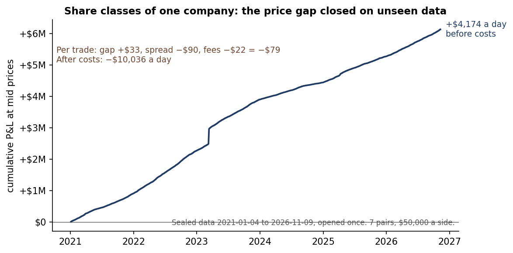
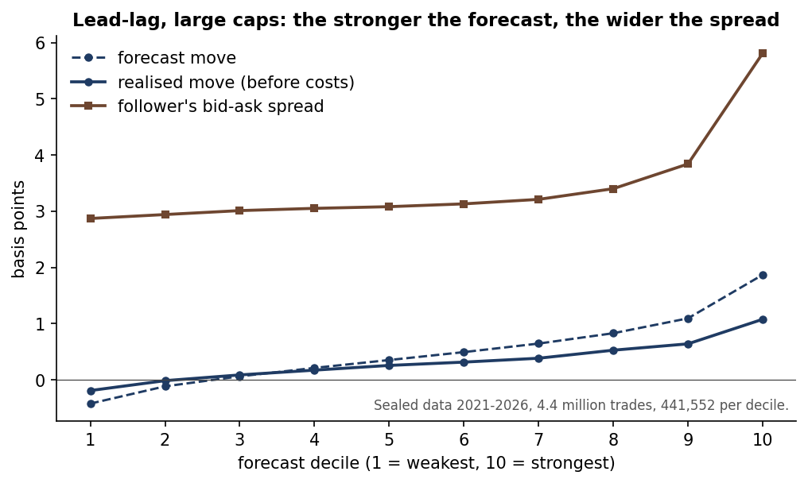
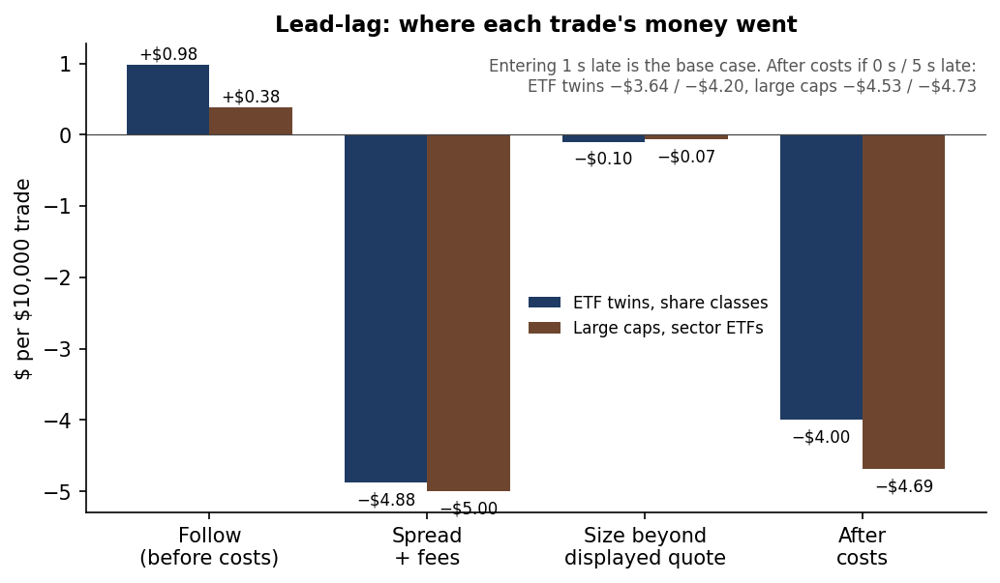

# Trading Under Real Costs

**Pre-registered tests of simple trading algorithms on second-by-second US stock data, with real spreads, fees and queues**
Kyle Park · Columbia University, *Algorithmic Trading with Market Simulator* course project · Fall 2026

> **In short.** Two price patterns held on data I had never seen. A follower stock really does move after its leader. Two share classes of one company really do close their gap.
> Neither one paid: the spread and fees cost 3 to 13 times the gain.
> The only rule that was worth money made no forecast. It waits 1¢ inside the spread for shares it has to buy anyway, and that saved **1.30¢ a share**.

## The question

Can a simple algorithm make money on US stocks once you count the real bid–ask spread, exchange fees and your place in the queue? I tested 31 strategy ideas, and every configuration I tried is counted: **911**. All the rules were fixed before I looked at any results.

## Method in three lines

1. **Rules first.** Settings, costs and the pass/fail test were committed to git before any result. For the four results below, tuning used 2015–2020 only. The sealed 2021–2026 data were opened once, after a code freeze, and never re-run.
2. **Realistic fills.** I replayed 1-second TAQ quotes and trades. Limit orders wait behind the displayed queue. Market orders pay the spread and $0.003 a share. The strictest rule also charges 1¢ for every share beyond the displayed size.
3. **Pre-set statistics.** Each verdict is a one-sided bootstrap test written down in advance. The bootstrap resamples days, or pair-days for lead-lag. → [METHOD.md](METHOD.md)

## Four results

### 1. Market making: in the real queue it lost money every day

I quoted 100 shares at the best bid and the best ask every 5 seconds, on 10 liquid stocks a year. This was build data, 2015–2020.

| Setting | After costs, 2015–2020 | Losing days |
|---|---|---|
| As designed, real queue | **−$5.42M** (−1.71¢ a share) | 1,511 of 1,511 |
| Best tuned setting | −$1.59M | 1,149 |
| First in line, nobody ahead (2019–20 check) | −$1.48M (−0.84¢ a share) | 99.6% |
| Upper bound: filled whenever a trade touches our price | +$0.71M (−$0.21M in 2015–18) | 622 |

- **Why it lost: adverse selection.** Five seconds after one of our limit orders filled, the price had moved 1.37 ticks against us on average.
  - Before costs, the strategy earned $5.73M of spread on its limit fills and lost $10.07M on the inventory it held.
- **Rebates are not enough.** With the class simulator's fee schedule (a 0.5¢ rebate on each limit share), the upper bound makes +$4.96M. The real queue still cannot get those fills.
- **Stopped on build data.** No setting passed, so the sealed data were never opened.


### 2. Share-class arbitrage: the gap closed on unseen data, and costs were 3× the gain

The strategy watches 7 pairs of share classes of one company, such as GOOGL and GOOG. When the gap is 2 standard deviations wide, it sells the dear class and buys the cheap one, $50,000 a side. Sealed test, 2021–2026:

- **The gap closes (confirmed).**
  - Before costs, the strategy made **+$4,174 a day** (95% CI 3,611 to 5,025, p < 0.0001) over 185,993 trades.
- **It does not pay.**
  - Per trade, closing the gap earned +$33. Crossing the spread cost −$90 and fees cost −$22, so each trade lost −$79.
  - After costs, the loss was **−$10,036 a day**. About 1 trade in 100 made money.
- **Other pair types (sealed):** the result is the same.
  - Same-industry stocks: +$1,421 a day before costs, −$3,582 after.
  - Near-identical ETFs: +$345 before costs, −$585 after.



### 3. Lead-lag: the follower really follows, but costs are 5–13× the gain (the main result)

**The trade.** The trigger is the leader's 15-second move, net of the follower's, passing 3 standard deviations. One second later, the strategy buys or sells the follower at market, $10,000 a trade. It exits at a target, a stop, 120 seconds or 15:55.

Two separate sealed tests confirmed the effect before costs:

| Pairs (sealed 2021–2026) | Trades | Before costs, $ a trade [95% CI] | Trades the forecast ranked top | After costs |
|---|---|---|---|---|
| ETF twins and share classes | 970,518 | **+0.98** [+0.95, +1.01] | +5.61 (top 2.2%) | **−4.00** (top −16.68) |
| Large caps after their sector ETF or SPY | 4,415,520 | **+0.38** [+0.36, +0.40] | +1.38 (top 12.7%) | **−4.69** (top −7.90) |


- **The forecast works, but its best trades are the most expensive.**
  - Forecast decile 10 has the largest realised move. It also has twice the spread: 5.8 bp, against 2.9 bp in decile 1.
  - After costs, decile 10 is the worst decile (−$8.45 a trade).
- **Waiting with a limit order makes it worse.**
  - Joining the bid instead of crossing the spread lost money before costs: −$0.70 a trade. Only 41% of the orders filled.
  - The fills came as the price moved against the order: adverse selection again.
- **The edge is shrinking.**
  - On large caps, the strategy made +$0.54 to +$0.60 a trade in 2021–23, but only +$0.15 to +$0.24 in 2024–26.
- **Speed is not the fix.**
  - Entering 0 seconds late instead of 1 still loses −$4.53 a trade on large caps and −$3.64 on ETF twins.
  - The spread is the cost.




### 4. Patient Trader: the one result worth money

**The rule.** The task is to buy (or sell) 1,000 shares within 5 minutes.
- Bid 1¢ inside the spread and keep your place in line.
- When the spread narrows to 1–2¢, buy the rest at market.
- At 5 minutes, buy whatever is left at market.

**Result.** The rule cost **1.30¢ a share less than a market order** (95% CI 1.14 to 1.46). This is the sealed test, 237,900 orders, 2021 to October 2025.
- Over the whole sealed period, the pre-registered test gave 1.50¢ [1.33, 1.67]. That period runs to October 2026 and includes the days after a data-unit change in November 2025 (see Limits).
- The saving reappeared on three sets of never-used stocks, under the strictest fill rules: 1.25, 1.63 and 1.29¢ a share.
- **It is a cost saving, not a profit.** It pays only on trades you have to make anyway.

## Limits

- **Simulated fills.** Fills are simulated on 1-second bars. Our own market impact is not modelled, and 1-second reaction is slow next to high-frequency traders.
- **Data error.** From 3 Nov 2025, the displayed quote sizes in the data are 100× too big. I found this after the fact and re-ran no sealed test. I quote the Patient Trader's result from before that date.
- **Confirmations are before costs.** The lead-lag and arbitrage confirmations are before costs. No strategy was confirmed to make money after costs.
- **Multiple testing.** Verdicts are corrected only within each study. The 911-trial count is published so that readers can judge the multiple testing across the whole project.

## Next steps

- **Use lead-lag as an execution signal, not a trade.** The Patient Trader already pays the spread on its market orders. Timing those orders by the leader's move costs nothing extra.
- **Re-test the Patient Trader on fresh data** with corrected quote sizes.

## What is here

```
README.md      this page
METHOD.md      pre-registration flow, data splits, fill and cost models, how trials are counted
LEDGER.md      all 911 trials, one row per study
results/       aggregated numbers behind the four results (JSON, CSV of daily totals)
figures/       the five figures above and make_figures.py, which draws them from results/ only
code/          engines only: fill simulators, cost accounting, lead-lag events, bootstrap and verdict code, tests
```

Data: WRDS TAQ (1-second quotes and trades) and CRSP. Licensed data are **not included**. Nor are quotes, trades or per-order records. Code: MIT license. Records: the pre-registration documents (Korean) up to the Market Maker rebuild are in this repository's history (commit `b36bf19`). Every study has spec, freeze and test-run tags in the private research repository.
