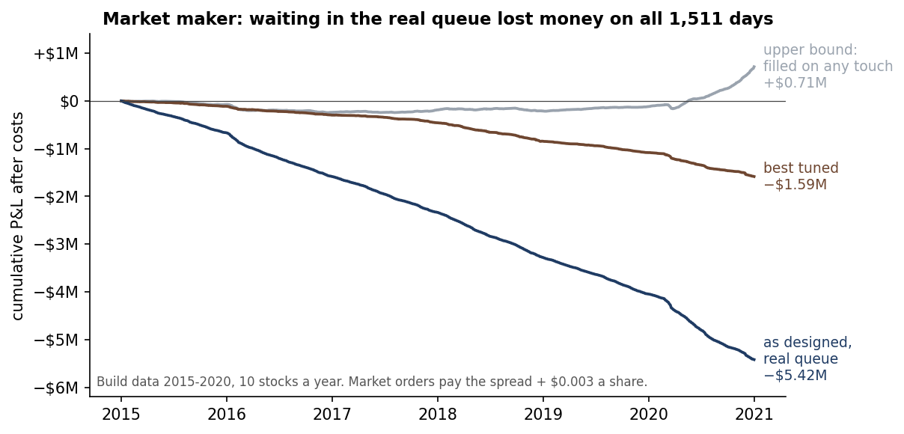
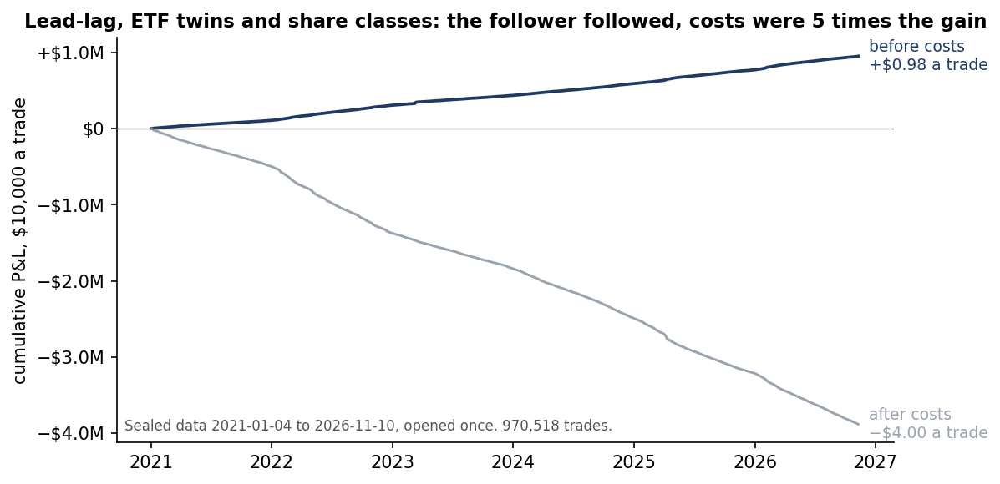

# Trading Under Real Costs

**Pre-registered tests of simple trading algorithms on second-by-second US stock data, with real spreads, fees and queues**
Kyle Park · Columbia University, *Algorithmic Trading with Market Simulator* course project · Fall 2026

> **In short.** Two price patterns held on data I had never seen. A follower stock really does move after its leader. Two share classes of one company really do close their gap.
> Neither one paid: the spread and fees cost 3 to 13 times the gain.
> The only rule that was worth money made no forecast. It waits 1¢ inside the spread for shares it has to buy anyway, and that saved **1.30¢ a share**.

## The question

Can a simple algorithm make money on US stocks once you count the real bid–ask spread, exchange fees and your place in the queue? I tested 31 strategy ideas, and every configuration I tried is counted: **911**. All the rules were fixed before I looked at any results.

## Method in three lines

1. **Rules first.** Settings, costs and the pass/fail test were committed to git before any result. For the four results below, tuning used 2015–2020 only. The sealed 2021–2026 data were opened once, after a code freeze, and never re-run. Exact dates: [Data periods](#data-periods).
2. **Realistic fills.** I replayed 1-second TAQ quotes and trades. Limit orders wait behind the displayed queue. Market orders pay the spread and $0.003 a share. The strictest rule also charges 1¢ for every share beyond the displayed size.
3. **Pre-set statistics.** Each verdict is a one-sided bootstrap test written down in advance. The bootstrap resamples days, or pair-days for lead-lag. → [METHOD.md](METHOD.md) · lead-lag pre-registration: [PREREG.md](PREREG.md) (summary at the top; the original plans are in Korean)

## Four results

### 1. Market making: in the real queue it lost money every day

I quoted 100 shares at the best bid and the best ask every 5 seconds, on 10 liquid stocks a year. This was build data, 2015–2020.

| Setting | After costs, 2015–2020 | Losing days |
|---|---|---|
| As designed, real queue | **−$5.42M** (−1.71¢ a share) | 1,511 of 1,511 |
| Best tuned setting | −$1.59M | 1,149 |
| First in line, nobody ahead (2019–20 check) | −$1.48M (−0.84¢ a share) | 99.6% |
| Upper bound: filled whenever a trade touches our price | +$0.71M (−$0.21M in 2015–18) | 622 |

- **Why it lost: adverse selection.** Five seconds after one of our limit orders filled, the price had moved 1.37 ticks against us on average.
  - Before costs, the strategy earned $5.73M of spread on its limit fills and lost $10.07M on the inventory it held.
- **Rebates are not enough.** With the class simulator's fee schedule (a 0.5¢ rebate on each limit share), the upper bound makes +$4.96M. The real queue still cannot get those fills.
- **Stopped on build data.** No setting passed, so the sealed data were never opened.



### 2. Share-class arbitrage: the gap closed on unseen data, and costs were 3× the gain

The strategy watches 7 pairs of share classes of one company, such as GOOGL and GOOG. When the gap is 2 standard deviations wide, it sells the dear class and buys the cheap one, $50,000 a side. Sealed test, 2021–2026:

- **The gap closes (confirmed).**
  - Before costs, the strategy made **+$4,174 a day** (95% CI 3,611 to 5,025, p < 0.0001) over 185,993 trades.
- **It does not pay.**
  - Per trade, closing the gap earned +$33. Crossing the spread cost −$90 and fees cost −$22, so each trade lost −$79.
  - After costs, the loss was **−$10,036 a day**. About 1 trade in 100 made money.
- **Other pair types (sealed):** the result is the same.
  - Same-industry stocks: +$1,421 a day before costs, −$3,582 after.
  - Near-identical ETFs: +$345 before costs, −$585 after.


### 3. Lead-lag: the follower really follows, but costs are 5–13× the gain (the main result)

**The trade.** The trigger is the leader's 15-second move, net of the follower's, passing 3 standard deviations. One second later, the strategy buys or sells the follower at market, $10,000 a trade. It exits at a target, a stop, 120 seconds or 15:55.

Two separate sealed tests confirmed the effect before costs:

| Pairs (sealed 2021–2026) | Trades | Before costs, $ a trade [95% CI] | Trades the forecast ranked top | After costs |
|---|---|---|---|---|
| ETF twins and share classes | 970,518 | **+0.98** [+0.95, +1.01] | +5.61 (top 2.2%) | **−4.00** (top −16.68) |
| Large caps after their sector ETF or SPY | 4,415,520 | **+0.38** [+0.36, +0.40] | +1.38 (top 12.7%) | **−4.69** (top −7.90) |



- **The forecast works, but its best trades are the most expensive.**
  - Forecast decile 10 has the largest realised move. It also has twice the spread: 5.8 bp, against 2.9 bp in decile 1.
  - After costs, decile 10 is the worst decile (−$8.45 a trade).
- **Waiting with a limit order makes it worse.**
  - Joining the bid instead of crossing the spread lost money before costs: −$0.70 a trade. Only 41% of the orders filled.
  - The fills came as the price moved against the order: adverse selection again.
- **The edge is shrinking.**
  - On large caps, the strategy made +$0.54 to +$0.60 a trade in 2021–23, but only +$0.15 to +$0.24 in 2024–26.
- **Speed is not the fix.**
  - Entering 0 seconds late instead of 1 still loses −$4.53 a trade on large caps and −$3.64 on ETF twins.
  - The spread is the cost.


### 4. Patient Trader: the one result worth money

**The rule.** The task is to buy (or sell) 1,000 shares within 5 minutes.
- Bid 1¢ inside the spread and keep your place in line.
- When the spread narrows to 1–2¢, buy the rest at market.
- At 5 minutes, buy whatever is left at market.

**Result.** The rule cost **1.30¢ a share less than a market order** (95% CI 1.14 to 1.46). This is the sealed test from 4 January 2021 to 31 October 2025: 237,900 orders. The test itself ran to 23 October 2026, and its last year is left out because of a data error.[^units]
- The saving reappeared on three sets of never-used stocks, under the strictest fill rules: **1.19, 1.63 and 1.29¢ a share**.[^sets]
- **It is a cost saving, not a profit.** It pays only on trades you have to make anyway.

[^units]: Every Patient Trader number here avoids a data error: from 3 Nov 2025 the displayed quote sizes are 100× too big (see Limits). The pre-registered test over the whole sealed period, 4 January 2021 to 23 October 2026, gave 1.50¢ [1.33, 1.67]. That is 2.75 bp of the $15.6 billion traded.
[^sets]: **The first set** (80 stocks, 381,440 orders) uses 2021–2024 only. Its results were split by calendar year, and these are the full years before the change. Its pre-registered result over the whole sealed period, to 3 November 2026, was 1.25¢. **The third and fourth sets** (579,220 and 558,560 orders, 4 January 2021 to 10 November 2026) read quote sizes corrected from that date, so their whole periods are used.

## Data periods

All tuning data start on 2 January 2015. Every sealed period starts on 4 January 2021, the first trading day of that year.

| Result | Exploration (tuning) | Validation | Sealed test, opened once | Last day tested | The number above uses |
|---|---|---|---|---|---|
| 1. Market making | 2015–2020 | — | never opened | 2020-12-31 | all of 2015–2020 |
| 2. Share-class arbitrage | 2015–2020 | — | 2021-01-04 to 2026-11-09 | 2026-11-09 | the whole sealed period |
| 3. Lead-lag, ETF twins and share classes | 2015–2018 | 2019–2020 | 2021-01-04 to 2026-11-10 | 2026-11-10 | the whole sealed period |
| 3. Lead-lag, large caps after their sector ETF or SPY | 2015–2018 | 2019–2020 | 2021-01-04 to 2026-11-16 | 2026-11-16 | the whole sealed period |
| 4. Patient Trader | 2015–2020 | — | 2021-01-04 to 2026-10-23 | 2026-10-23 | **2021-01-04 to 2025-10-31** (1.30¢) |
| 4. Patient Trader, first new stock set | 2015–2020 | — | 2021-01-04 to 2026-11-03 | 2026-11-03 | **2021–2024** (1.19¢) |
| 4. Patient Trader, third new stock set | 2015–2020 | — | 2021-01-04 to 2026-11-10 | 2026-11-10 | the whole sealed period (1.63¢) |
| 4. Patient Trader, fourth new stock set | 2015–2018 | 2019–2020 | 2021-01-04 to 2026-11-10 | 2026-11-10 | the whole sealed period (1.29¢) |

**Why the end dates differ.** Each sealed period ends on the last day of data its study had, and the sealed tests ran between 30 October and 21 November 2026. Two Patient Trader numbers stop earlier on purpose: they leave out the data from 3 November 2025, where the quote sizes are wrong (see Limits).

- The new stock sets were tuned on the original stocks and sealed-tested on stocks never used before.
- Under result 1, the first-in-line row is a 2019–2020 check.
- Under result 2, the other pair types were sealed-tested from 2021-01-04 to 2026-11-10.

## Limits

- **Simulated fills.** Fills are simulated on 1-second bars. Our own market impact is not modelled, and 1-second reaction is slow next to high-frequency traders.
- **Data error.** From 3 Nov 2025, the displayed quote sizes in the data are 100× too big. I found this after the fact and re-ran no sealed test. The Patient Trader numbers avoid the affected data (notes under result 4). The later lead-lag studies read corrected sizes.
- **Confirmations are before costs.** The lead-lag and arbitrage confirmations are before costs. No strategy was confirmed to make money after costs.
- **Multiple testing.** Verdicts are corrected only within each study. The 911-trial count is published so that readers can judge the multiple testing across the whole project.

## Next steps

- **Use lead-lag as an execution signal, not a trade.** The Patient Trader already pays the spread on its market orders. Timing those orders by the leader's move costs nothing extra.
- **Re-test the Patient Trader on fresh data** with corrected quote sizes.

## What is here

```
README.md      this page
METHOD.md      pre-registration flow, data splits, fill and cost models, how trials are counted
PREREG.md      the two lead-lag tests: hypotheses, gates, dates, tags and plan hashes (summary at the top)
LEDGER.md      all 911 trials, one row per study
results/       aggregated numbers behind the four results (JSON, CSV of daily totals)
figures/       the five figures above and make_figures.py, which draws them from results/ only
code/          engines only: fill simulators, cost accounting, lead-lag events, bootstrap and verdict code, tests
requirements.txt   package versions for the steps under "How to run"
```

## How to run

The steps below need no market data. The tests build synthetic markets in code, and the figures use the aggregated files in `results/`.

**1. Requirements.** Python 3.13 and the packages pinned in [requirements.txt](requirements.txt): numpy 2.3.5, pandas 2.2.3, scipy 1.18.1, statsmodels 0.14.5, numba 0.68.1, matplotlib 3.10.7 and pytest 8.4.2. Checked on 2026-11-25 in a fresh virtual environment (Python 3.13.3, macOS on Apple silicon).

**2. Install.** Clone this repository, then run these commands in its folder:

```bash
python3.13 -m venv .venv
source .venv/bin/activate
pip install -r requirements.txt
```

**3. Run the tests.**

```bash
(cd code/market_maker && python -m pytest -p no:cacheprovider -q tests)
(cd code/execution && python test_engine17.py)
```

- The first command takes about 6 minutes and ends with `76 passed, 14 skipped`. The skipped tests write scratch files, so they need `R12_TEST_DIR` set to an empty folder outside the repository.
- The second command takes about 1 second and ends with `40/40 passed`. It writes `code/execution/results/engine17_tests.json`, which git ignores.

**4. Redraw the figures.**

```bash
python figures/make_figures.py
```

This reads `results/` only and overwrites the five PNG files in `figures/`. It prints one `drew <name>` line per figure. In the check, the redrawn images matched the committed ones pixel for pixel. Git still lists them as modified, because the file bytes differ.

**5. What cannot be re-run.** The studies themselves need WRDS TAQ quotes and trades and CRSP data. These are licensed and not included, so the results cannot be reproduced from this repository alone.

- `code/market_maker` and `code/execution` expect one `.npz` file per stock and day under `$DATA_DIR`. Each file holds 21 int32 columns of 23,400 one-second bars (09:30–16:00), with prices in 1/10,000 dollar and sizes in shares. The columns are listed in `code/market_maker/bars1s/bars.py`.
- `code/lead_lag` reads the same bar files for the leader and the follower. It also imports modules of the private research repository, so it is here for reading only.

Data: WRDS TAQ (1-second quotes and trades) and CRSP. Licensed data are **not included**. Nor are quotes, trades or per-order records. Code: MIT license. Records: the pre-registration documents (Korean) up to the Market Maker rebuild are in this repository's history (commit `b36bf19`). Every study has spec, freeze and test-run tags in the private research repository.
