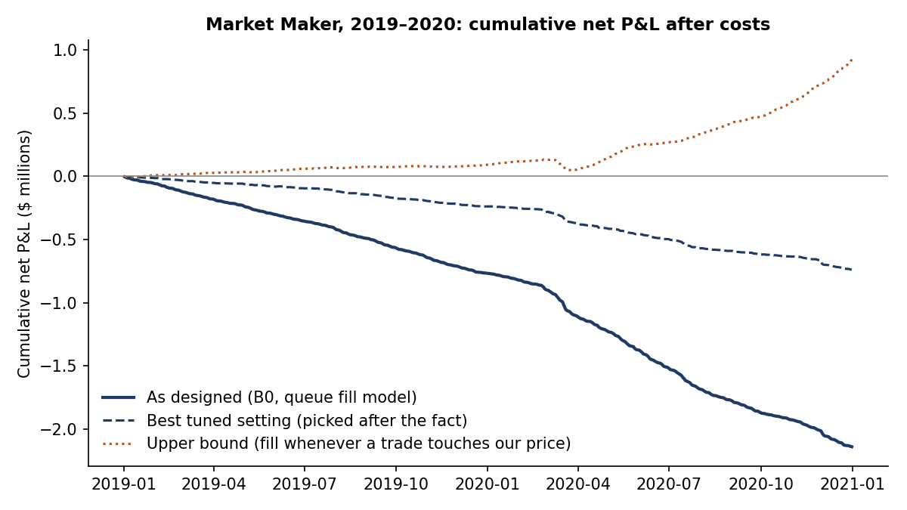
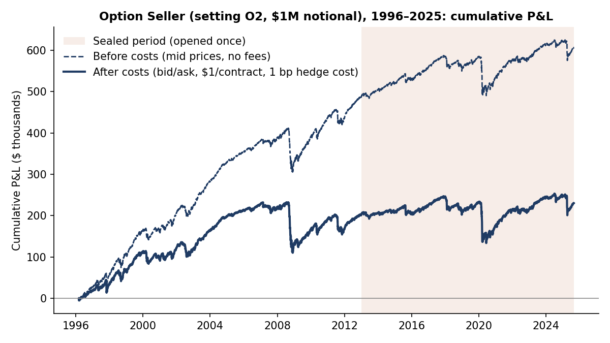
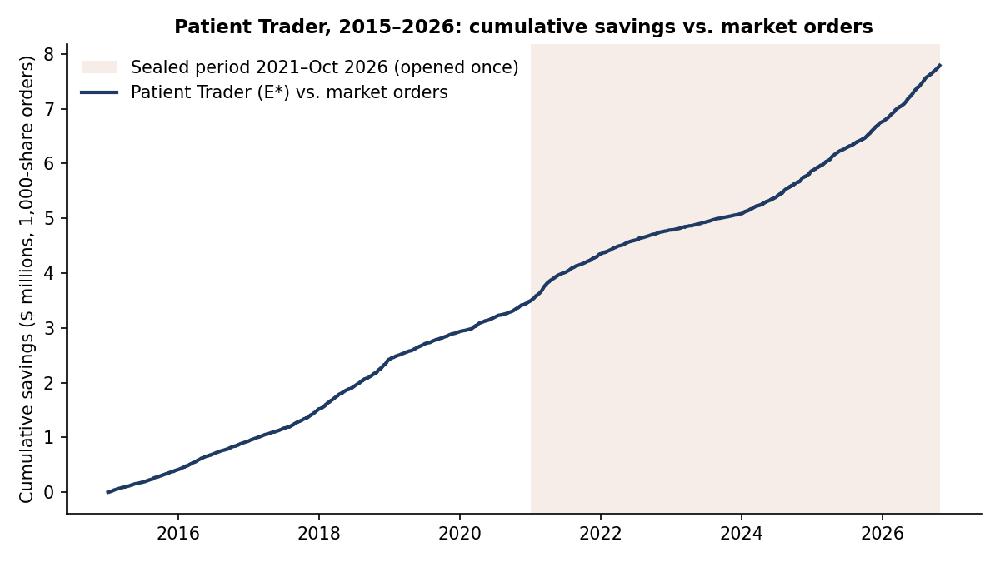

# Trading Under Real Costs

**Pre-registered tests of three simple trading algorithms on real market data**
Kyle Park · Columbia University, *Algorithmic Trading with Market Simulator* course project · Fall 2026

> Two algorithms that tried to **earn** the bid–ask spread could not beat trading costs on unseen data.
> One that tried to **pay less** of it saved 1.5¢ a share on six years of sealed data.

Data: WRDS TAQ (1-second quotes and trades), CRSP, OptionMetrics. Raw data are licensed and **not included** in this repository.

---

## Results at a glance

| Algorithm | What it trades | Test design | Result (after costs) |
|---|---|---|---|
| **Market Maker** | 20 liquid US stocks (10 a year; $10–150, 3–12¢ spreads); quotes both sides every 5 s, max 300 shares | Build 2019–2020 (failed, so the sealed data were never opened) | −1.8¢/share; lost money on all 505 days; Sharpe −25.7. Even standing **first in line**: −0.84¢/share |
| **Market Maker + ML** | Same, plus a LightGBM model that decides when to quote (each test year trained only on earlier years, from 2015) | Validation 2019–2020 | Loss cut to −1.05¢/share, Sharpe −3.7 (best setting, picked after the fact). Still fails |
| **Option Seller** | S&P 500 options: sell a 1-month strangle every day, delta-hedge daily | Build 1996–2012 → **sealed 2013–Aug 2025**, opened once | Sharpe 0.55 → **0.10**. **Inconclusive**, near zero (pass bar 0.5; buy-and-hold S&P 500 was 0.77). A drawdown condition was dropped after seeing the build results; see docs. |
| **Patient Trader** (execution) | 1,000-share orders with a 5-min deadline, 10 liquid US stocks a year | Picked on 2015–2020 → **sealed 2021–Oct 2026**, opened once (286,700 orders) | **−1.50¢/share vs. market orders** (95% CI −1.67 to −1.33), 2.75 bp; −1.40¢ vs. TWAP; Sharpe of daily savings 17.9; stress test on 2015–2020 build data with strict fill and depth rules: still −1.43¢ |

**Lesson:** the spread is the wall, from both sides. Market makers lose because the traders who hit their quotes know the price is about to move, even when the market maker stands first in line. A slow trader's edge is on the cost side: waiting 1¢ inside the spread instead of crossing it.







More figures are in the study summaries: [Study 12](docs/study12_market_maker.md) · [Studies 13–14](docs/study13_14_option_seller.md) · [Study 15](docs/study15_ml_and_execution.md) · [Study 16](docs/study16_followups.md)

## How we kept the results honest

1. **Rules first.** Every setting, cost assumption and pass/fail test was written down and committed (with a timestamp and hash) before any result was computed.
2. **Build vs. sealed data.** Settings were chosen on a build period only. The sealed period was opened exactly once, with a typed unlock phrase, and never re-run.
3. **Every try counted.** All configurations across all studies were logged (722 trials), and every departure from the plan is recorded in a deviations log.
4. **Realistic costs.** Real bid–ask spreads, $0.003/share on market orders, fills that wait in line behind displayed orders, option bid/ask plus $1/contract, and before-cost results shown next to after-cost results.
5. **Stress tests on the one positive result.** Stricter fill rules (only trades through our price; at most the displayed size) and a depth penalty for large market orders (run on the 2015–2020 build data).

## Repository layout

```
trading-under-real-costs/
├── .gitignore
├── LICENSE
├── README.md
├── docs/    # one-page English summary per study; pre-registration records (Korean)
│   ├── preregistration/
│   ├── study12_market_maker.md
│   ├── study13_14_option_seller.md
│   ├── study15_ml_and_execution.md
│   └── study16_followups.md
├── figures/    # made by src/common/make_figures.py from results/
│   ├── ml_vs_no_ml.png
│   ├── mm_cumulative_pnl.png
│   ├── mm_queue_position.png
│   ├── option_seller_cumulative.png
│   ├── patient_trader_savings.png
│   └── patient_trader_stress.png
├── results/    # aggregated outputs only (daily P&L, summaries)
│   ├── study12/
│   ├── study13_14/
│   ├── study15/
│   ├── study16/
│   └── universe_tickers.csv
└── src/    # study code, copied as run (paths generalised)
    ├── common/
    ├── study12_market_maker/
    ├── study13_14_option_seller/
    ├── study15_ml_execution/
    └── study16_followups/
```

## Reproducing

The code needs a WRDS subscription (TAQ, CRSP, OptionMetrics). Set `DATA_DIR` to your local data folder; see each study's README. No licensed data, raw quotes or per-order outputs are included; `results/` holds only aggregated outputs (daily P&L series and summary statistics).

## Earlier studies

| # | Name | Idea | Data · period | Result (sealed/holdout period) |
|---|---|---|---|---|
| 1 | Sub-second order-book imbalance | Does 1-second NBBO quote imbalance predict the mid-price 1–10 s ahead by enough to pay the spread? | WRDS TAQ millisecond quotes/trades, AAPL·MSFT·SH, self-built 1-s NBBO bars; 2026-09-14 – 10-16 (25 days) | No sealed test. Build period: the signal is real (corr 0.02–0.07 AAPL/MSFT, 0.22–0.43 SH), but edge minus spread is negative in all 60 cells. |
| 2 | LastHalfHour | Market intraday momentum (Gao, Han, Li & Zhou 2018): the first-half-hour return predicts the 15:30–16:00 return | WRDS TAQ NBBO snapshots + closing prints; SPY (QQQ, SH robustness); build 2021–24, holdout 2025-01-02 – 2026-10-22 | SPY net −$3.22/day, t −0.32 (Sharpe −0.24) over 445 holdout days; fail (rule required t ≥ 1.65). |
| 3 | AfterTheBell | Closing-auction gaps revert by the next open (Bogousslavsky & Muravyev): enter at 16:05 after-hours against the gap, exit at the open | WRDS TAQ ms; SPY (QQQ, IWM, DIA); build 2021–24, holdout A 2010–2020, holdout B 2025–26 | SPY net −$6.12/day, t −0.55 (Sharpe −0.17) on 2010–2020 holdout A; fail (needed t ≥ 1.65). Holdout B also negative (t −1.64). |
| 4 | SlowRotation | Sector momentum (Moskowitz & Grinblatt 1999): hold the top-3 sector SPDRs by 12-1 month return against short SPY, rebalanced monthly | CRSP daily, 9–11 Select Sector SPDRs + SPY; build 2000–05, holdout 2006–2024 (228 months) | Net −$143/month, t −0.98 (Sharpe −0.23) on 2006–2024; fail (needed t ≥ 1.65). Gross was also negative (−$88/month). |
| 5 | EarningsSeason | Earnings-announcement premium: buy large caps from day −2 to day +1 around earnings, hedged with the sector ETF | CRSP + IBES + Compustat, top-500 US stocks; build 2000–09, holdout 2010–2024 | Net −$90/day, Newey-West t −2.60 (Sharpe −0.73) on 2010–2024; fail (needed t ≥ 1.65). |
| 6 | RiskManagedPortfolio | Inverse-volatility risk parity over 9 asset-class ETFs with a 10% vol target (leverage cap 1.0 primary, 1.5 secondary) vs SPY and 60/40 | CRSP daily, 9 ETFs; build 2007–16, holdout 2017–2024 | Net Sharpe 0.28 [−0.42, 1.08] vs SPY 0.72 and 60/40 0.66 on 2017–2024; fail (needed CI above 0 and beating both). |
| 7 | ExecutionCost | Not an alpha study: do TWAP/VWAP/POV/passive-then-cross schedules cut implementation shortfall vs an immediate market order? | WRDS TAQ ms, AAPL·MSFT·SH; build 2026-09-14 – 10-16, holdout 2026-07-13 – 08-14 (25 days each) | 0 of 24 algorithm × order-size comparisons showed a significant saving; 2 "no effect", 22 inconclusive (4 of them model-dependent). |
| 8 | PairsArb | Gatev–Goetzmann–Rouwenhorst distance pairs (top 20 same-industry pairs, 6-month trading window): do the profits survive costs after 2000? | CRSP daily, top-1,500 US stocks; build 2000–09, holdout 2010–2024 | Net Sharpe −0.10 [−0.56, 0.31] on 2010–2024; verdict (b): falls short of the 0.5 bar. |
| 9 | MultiFactor | Five factors (momentum, gross profitability, low beta, value, investment) in a dollar-neutral long-short plus a long-only tilt, monthly | CRSP monthly + Compustat, top-1,000 US stocks; build 1978–99, holdout 2000–2024 | Long-short net Sharpe 0.25 [−0.31, 0.69]; long-only IR 0.25 [−0.26, 0.65] (97.5% CIs), 2000–2024; both inconclusive, (c)/(c′). |
| 10 | TrendFutures | 12-month time-series momentum on 41 diversified futures (Moskowitz, Ooi & Pedersen 2012), volatility-scaled | Datastream futures (WRDS), 41 markets; build 1980–99, holdout 2000 – Mar 2026 | Net Sharpe 0.54 [0.25, 0.83] on 2000–Mar 2026; verdict (a) survives, though below the 0.59 detectable minimum. Post-2010: 0.39, inconclusive. |
| 11 | FastPairs | Cost-aware short-horizon pairs: top-100 large caps, same-industry cointegrated pairs with a 3–20 day half-life; enter at z = 2, exit at 0.5 | CRSP daily, top-100 stocks; build 2000–09, holdout 2010–2024 (+ fresh 2025) | Net Sharpe −0.51 [−0.97, −0.05] on 2010–2024 (already seen in study 8); verdict (b): falls short. 2025: −0.26 [−2.53, 1.86]. |

*Studies 8–11 use three verdicts, fixed before the holdout was opened. (a) survives: the 95% CI excludes 0 and the point estimate is ≥ 0.5. (b) falls short: the CI upper bound is below 0.5. (c) inconclusive: neither. Study 9's long-only tilt uses the same rule with an IR bar of 0.3, marked (c′). Studies 2–5 used a one-sided t ≥ 1.65 rule on mean daily or monthly net P&L. All costs are included. The code and results of studies 1–11 are not part of this repository.*

## License

Code: MIT. Data: not included (WRDS terms of use).
