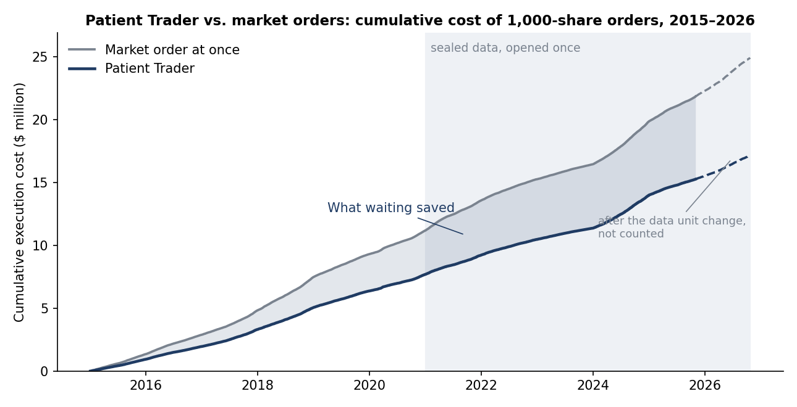

# Trading Under Real Costs

**Pre-registered tests of six trading algorithms on second-by-second US market data**
Kyle Park · Columbia University, *Algorithmic Trading with Market Simulator* course project · Fall 2026

> Every second-by-second backtest held on data it had never seen. Only one was worth money after costs:
> an execution rule that pays less of the bid–ask spread. It saved **1.30¢ a share, 29% of the cost of a market order**,
> on sealed data and again on three sets of stocks it had never used.

Data: WRDS TAQ (1-second quotes and trades), CRSP, OptionMetrics, FRED. Licensed data are **not included**.

---

## Results at a glance

| Algorithm | Idea | How it was tested | Result after costs | Verdict |
|---|---|---|---|---|
| [Market Maker](docs/market_maker.md) | Quote both sides every 5 s and earn the spread | Build 2015–2020 only | −1.7¢ a share; lost money on all 1,511 days. Even first in line (2019–20 check): −0.84¢ | Stopped on build data |
| **[Patient Trader](docs/ml_market_maker_and_patient_trader.md)** (execution) | Fill 1,000 shares within 5 min: wait 1¢ inside the spread, cross when it narrows to 1–2¢, finish at market | Picked on 2015–2020 → sealed 2021–Oct 2025, opened once; then three random sets of never-used stocks | **1.30¢ a share cheaper than a market order** (95% range 1.14–1.46); 1.19 · 1.63 · 1.29¢ on the new stocks under the strictest fill rules | Held, 4 times |
| [Order-book forecast](docs/smarter_patient_trader.md) | Predict an adverse move every 5 s and act on it | Build 2015–2020 → sealed, new stocks 2021–2026 | AUC 0.591 on unseen stocks (0.601 with trade and market inputs). No rule using it beat plain waiting by the 0.02¢ bar | Predicted, did not pay |
| [Statistical arbitrage](docs/stat_arb_pairs.md) | Trade the gap between near-identical prices: same company, same industry, ETF twins | Build 2015–2020 → sealed 2021–2026 | The gap closed in all three kinds (same company: +$4,174 a day before costs), but costs were about 3× the gain (−$10,036 a day after) | Predicted, did not pay |
| [Option Seller](docs/option_seller.md) | Sell 1-month S&P 500 strangles, delta-hedged | Build 1996–2012 → sealed 2013–Aug 2025 | Sharpe 0.55 → 0.10 (buy-and-hold S&P 500: 0.77) | Did not hold |
| [Currency carry](docs/carry_trade.md) | Each month buy the 3 highest-rate G10 currencies, sell the 3 lowest | Build 1990–2012 → sealed 2013–Feb 2026 | Sharpe 0.35 → 0.04; costs took 80% of the profit | Did not hold |



## What I learned

1. **The spread is the wall.** The market maker lost trying to earn it. The forecast and the arbitrage were right about direction and still lost paying it.
2. **The winner made no forecast.** The Patient Trader only waits 1¢ inside the spread for shares it has to trade anyway.
3. **Predictable is not profitable.** Forecasts held on unseen stocks (AUC 0.59–0.60), and a volatile minute did predict a bigger next move, but not its direction. Acting early on any signal always cost more.
4. **Speed decides who can arbitrage.** Entering 1 second late kept 81% of the gain, 5 seconds 58%, 30 seconds 25%. A patient limit-order version cost more than market orders.
5. **Fast backtests held; slow ones did not.** Every second-by-second backtest held on sealed data. Both slow strategies, Sharpe 0.35–0.55 at build, fell to 0.10 or less.

## How the results were kept honest

1. **Rules first.** Every setting, cost assumption and pass/fail test was written down and committed before any result was computed.
2. **Build vs. sealed data.** Settings were chosen on build years only. Sealed data were opened once, with a typed unlock phrase, and never re-run. Ideas that failed on build data never touched sealed data.
3. **Every try counted.** 892 configurations across all studies are logged, including every one that failed.
4. **Realistic costs.** Real bid–ask spreads, $0.003 a share on market orders, fills that wait in line behind displayed orders, and a strictest rule: filled only by trades through our price, at most the displayed size, +1¢ beyond it.
5. **Replication.** The Patient Trader was re-tested on three random draws of 20 never-used stocks a year, each opened once.
6. **Errors reported.** From 3 Nov 2025, displayed quote sizes in our data are 100× too big. We found it ourselves, did not rerun any sealed test, and now quote results before that date (1.30¢ instead of 1.50¢). See [docs/data_unit_correction.md](docs/data_unit_correction.md).

Pre-registration documents are in `docs/preregistration/` (Korean). Their tags and hashes refer to the private research repository; this repository is a clean copy.

## Every attempt, one line each

| What we tried | Judged on | Result | Verdict |
|---|---|---|---|
| Market Maker | Build 2015–20 | −1.7¢ a share; lost on all 1,511 days | Stopped on build data |
| Option Seller | Sealed 2013–25 | Sharpe 0.55 in backtest, 0.10 sealed | Did not hold |
| Currency carry trade | Sealed 2013–26 | Sharpe 0.35 in backtest, 0.04 sealed | Did not hold |
| Patient Trader vs. market order | Sealed, 4 stock sets | Saved 1.30, 1.19, 1.63, 1.29¢ a share | Held, 4 times |
| + spread switch | Sealed, new stocks | 0.13¢ cheaper; plain waiting nearly matched it | Held, small |
| + order-book forecast | Sealed, new stocks | AUC 0.591; no cost gain on build data | Predicted, did not pay |
| + the market's move (SPY) | Build 2015–20 | 0.006¢ cheaper; the bar was 0.02¢ | Stopped on build data |
| + all signals in one model | Sealed, new stocks | AUC 0.601; 0.006¢ cheaper on build data | Predicted, did not pay |
| + last-minute volatility, volume | Build 2019–20 | 0.004¢ cheaper; the bar was 0.02¢ | Stopped on build data |
| Stat-arb, same company | Sealed 2021–26 | +$4,174 a day before costs, −$10,036 after | Predicted, did not pay |
| Stat-arb, same industry | Sealed 2021–26 | +$1,421 a day before costs, −$3,582 after | Predicted, did not pay |
| Stat-arb, near-identical ETFs | Sealed 2021–26 | +$345 a day before costs, −$585 after | Predicted, did not pay |
| Stat-arb, biggest gaps only | Build 2015–20 | Gain 97% of cost; −$0.23 a day when 1 second late | Stopped on build data |

Details: [Market Maker](docs/market_maker.md) · [Patient Trader](docs/ml_market_maker_and_patient_trader.md) · [stress tests](docs/followups_and_stress_tests.md) · [new stocks](docs/patient_trader_new_stocks.md) · [making it smarter](docs/smarter_patient_trader.md) · [stat-arb](docs/stat_arb_pairs.md) · [option seller](docs/option_seller.md) · [carry trade](docs/carry_trade.md) · [data correction](docs/data_unit_correction.md) · [earlier studies](docs/earlier_studies.md)

## Repository layout

```
trading-under-real-costs/
├── .gitignore
├── LICENSE
├── README.md
├── docs/    # English summaries; pre-registration records (Korean)
│   ├── carry_trade.md
│   ├── data_unit_correction.md
│   ├── earlier_studies.md
│   ├── followups_and_stress_tests.md
│   ├── market_maker.md
│   ├── ml_market_maker_and_patient_trader.md
│   ├── option_seller.md
│   ├── patient_trader_new_stocks.md
│   ├── smarter_patient_trader.md
│   ├── stat_arb_pairs.md
│   └── preregistration/
├── figures/    # made by src/common/make_figures*.py from results/
│   ├── ml_vs_no_ml.png
│   ├── mm_cumulative_pnl.png
│   ├── mm_queue_position.png
│   ├── option_seller_cumulative.png
│   ├── patient_trader_cost_lines.png
│   ├── patient_trader_savings.png
│   ├── patient_trader_stress.png
│   ├── replication_by_year.png
│   ├── stat_arb_by_year.png
│   └── stat_arb_latency.png
├── results/    # aggregated outputs only
│   ├── study12/
│   ├── study13_14/
│   ├── study15/
│   ├── study16/
│   ├── study17/
│   ├── study18/
│   ├── study19/
│   ├── study20/
│   ├── study21/
│   ├── study22/
│   ├── study23/
│   ├── study24/
│   ├── study25/
│   ├── study26/
│   └── universe_tickers.csv
└── src/    # study code, copied as run (paths generalised)
    ├── common/
    ├── study12_market_maker/
    ├── study13_14_option_seller/
    ├── study15_ml_execution/
    ├── study16_followups/
    ├── study17_new_stocks/
    ├── study18_forecast/
    ├── study19_carry/
    ├── study20_pairs/
    ├── study21_more_pairs/
    ├── study22_market_signal/
    ├── study23_combined_forecast/
    ├── study24_big_gaps/
    ├── study25_volatility/
    └── study26_market_maker_2015_2020/
```

## Reproducing

The code needs a WRDS subscription (TAQ, CRSP, OptionMetrics). Set `DATA_DIR` to your local data folder; see each study's README. `results/` holds only aggregated outputs. No licensed data, quotes or per-order results are included.

## License

Code: MIT. Data: not included (WRDS terms of use).
