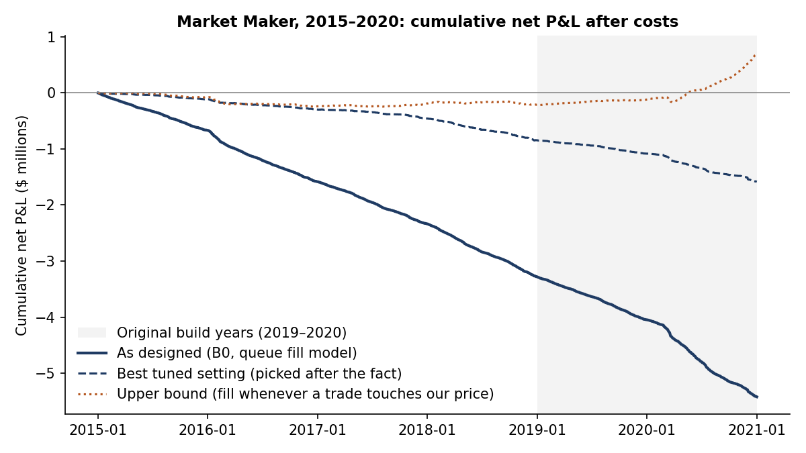

# Market Maker

**Question.** Can a passive market maker earn money after realistic costs? It quotes at the best bid and offer of wide-spread US stocks and decides once per second, without co-location.

**Data and period.** WRDS TAQ, reduced to 1-second NBBO and trade bars.
- **Stocks:** each year, 10 common stocks are drawn at random from those passing prior-year screens: price $10–150, median daily dollar volume $5M–100M, at least 3,000 trades a day, and a median spread of 3–12 ticks. That gives 20 names over the build period.
- **Build period:** 2019–2020 (505 days).
- **Sealed period:** 2021–2026 was never opened (see the test below).
- **Rebuild:** the same grid and rules were later re-run on 2015–2020 (1,511 days). See the last section.

**Algorithm rules (setting B0).**
- **Quoting:** from 09:45 to 15:55, whenever the spread is 2–12 ticks, join the best bid and the best ask with 100 shares each, re-posting every 5 s.
- **Inventory:** capped at ±300 shares. After 60 s at the cap, one 100-share lot is traded at market.
- **Close:** flat at 15:55.

**The grid.** 18 alternatives each changed one rule at a time. Every change that raised the Sharpe ratio by at least 0.5 was combined into **C_all**, the "best tuned" setting: keep queue place, a 500-share cap, a 120 s timer, long-only, spread ≥ 4 ticks, and an active-trading gate. The grid had 26 settings in total.

**Fill model and costs.**
- **Q (the verdict model):** our order waits behind the displayed queue and fills only after enough volume trades at our price.
- **T (optimistic upper bound):** fills in full whenever any trade touches our price.
- **Cost R:** market orders pay $0.003 a share plus the spread. Limit orders are free, with no rebate.

**Pre-registered pass/fail test.** Under Q and R, a setting qualifies only if all of these hold:
- Sharpe > 0 in both 2019 and 2020;
- Sharpe > 0 with half the queue;
- at least 1 fill per stock-day while staying under 1% of market volume;
- neighbouring settings have Sharpe ≥ 0.

If no setting qualifies, the study stops. A qualifier would also need a build Sharpe ≥ 1.0 before a single sealed run, judged by its 95% bootstrap CI (lower bound > 0 and Sharpe ≥ 0.5).

## Results

2019–2020, cost R, annualized Sharpe.

| Setting | Net | ¢/share | Sharpe | Losing days |
|---|---|---|---|---|
| B0, Q (as designed) | −$2.14M | −1.79 | −25.7 | 505 of 505 |
| C_all, Q (best tuned) | −$0.74M | −1.57 | −11.1 | 424 of 505 |
| B0, T (upper bound) | +$0.93M | +0.24 | +8.9 | 112 of 505 |

- **Volume:** B0 filled 107.8M shares with limit orders and 11.4M at market.
- **Where the loss comes from:** adverse selection. Five seconds after a fill, the mid-price had moved about 1.5 ticks against us.
- **Placebo:** the order-book imbalance filters did no better than shuffled signals.
- **Verdict:** 0 of 26 settings qualified.
- **Caveat on "best tuned":** C_all was tuned in-sample on the same build data. It is the best of the 26 grid settings, not of everything tried.

**Conclusion.** With a realistic queue, quoting at the best price lost money on every single day, because the fills we got were the ones that moved against us. Only the queue-free model made money, and it needed 13% of market volume to do so. Any edge depends on a queue position that a 1-second trader cannot secure. The [follow-ups](followups_and_stress_tests.md) (part B) measure how much the queue position is worth. As pre-registered, the study stopped and the 2021–2026 data stayed unused.

## Rebuilt on 2015–2020

**Why.** The Market Maker was built on two years (2019–2020), while the other second-by-second strategies were built on 2015–2020. This rebuild runs the same 26-setting grid, the same adoption rule and the same pass/fail test on all six years: 14,800 stock-days over 1,511 trading days. The yearly-Sharpe filter now needs Sharpe > 0 in each of the six years. A setting still needs a build Sharpe ≥ 1.0 to earn a sealed run.
- **Stocks:** 2015–2018 uses 10 stocks a year, drawn with the same screens in the Patient Trader study. 2019–2020 uses the original 20.
- **Order of work:** the rules and predictions were committed before any 2015–2018 profit or loss was computed.
- **Left out:** the ETF comparison step, because there are no ETF bars before 2019.

**Result.** No setting qualified. All 26 failed both the yearly-Sharpe filter and the half-queue filter.
- The same changes were adopted as in 2019–2020, so the best tuned setting is again C_all.
- The 2019–2020 part reproduced the original results exactly: a difference of $0 on every day.
- The sealed data stayed unopened.

Net P&L in $ millions, cost R. Sharpe is annualized.

| Setting, fill model | 2015 | 2016 | 2017 | 2018 | 2019 | 2020 | 2015–20 | ¢/share | Sharpe | Losing days |
|---|---|---|---|---|---|---|---|---|---|---|
| As designed (B0), Q | −0.67 | −0.92 | −0.75 | −0.94 | −0.77 | −1.37 | −5.42 | −1.71 | −28.6 | 1,511 of 1,511 |
| As designed, S | −0.69 | −0.94 | −0.75 | −0.97 | −0.80 | −1.51 | −5.65 | −2.25 | −28.5 | 1,511 of 1,511 |
| As designed, T (upper bound) | −0.08 | −0.16 | +0.05 | −0.02 | +0.09 | +0.83 | +0.71 | +0.07 | +3.1 | 622 of 1,511 |
| Best tuned (C_all), Q | −0.12 | −0.19 | −0.16 | −0.39 | −0.24 | −0.50 | −1.59 | −1.44 | −9.3 | 1,149 of 1,511 |
| Best tuned, S | −0.17 | −0.28 | −0.22 | −0.45 | −0.29 | −0.69 | −2.10 | −2.87 | −12.0 | 1,291 of 1,511 |
| Best tuned, T (upper bound) | +0.22 | +0.20 | +0.32 | +0.23 | +0.30 | +2.00 | +3.28 | +0.53 | +7.9 | 287 of 1,511 |

**S (strictest)** fills only when the opposite quote moves through our price.

- **The earlier years were no better.** As designed under Q:
  - 2015–2018: −$3.28M (−1.66¢ a share, Sharpe −35.0)
  - 2019–2020: −$2.14M (−1.79¢ a share, Sharpe −25.7)
  - Even the upper bound lost money in 2015–2018 (−$0.21M).
- **Placebo:** the order-book and trade-flow filters did worse than random. Each real filter was compared with the same filter run on 200 shuffled signals, by net P&L per filled share:

| Filter | Real filter | 200 shuffles | Real filter is worse than |
|---|---|---|---|
| Order-book imbalance | −1.964¢ | −1.953 to −1.938¢ | all 200 |
| Trade-flow imbalance | −1.940¢ | −1.942 to −1.927¢ | 97% of them |

- **Adverse selection** is the cause of the losses. It is measured as the mid-price move after our limit fills, in ticks (1 tick = 1¢), under Q. Negative means the price moved against us.
  - For the as-designed setting, the 5-second move grew from −0.96 ticks in 2015 to −1.65 in 2018.
  - It is worst in the first hour of trading.

| Setting | 1 s | 5 s | 30 s | 60 s | 5 s, first hour | 5 s, 11:30–12:30 | 5 s, last hour |
|---|---|---|---|---|---|---|---|
| As designed | −1.17 | −1.37 | −1.56 | −1.57 | −1.99 | −1.37 | −1.11 |
| Best tuned | −0.77 | −1.02 | −1.27 | −1.30 | −1.42 | −0.91 | −0.86 |

**Conclusion.** The Market Maker did not make money after costs on 2015–2020 either, so the sealed data were not opened. The rebuild added 27 configurations to the log, for 892 in all.

**Records.** Study 12. Sources: `results/study12/` (`s12_summary.json`, `s12_daily_pnl.csv`, `dev_summary.json`, `dev_grid.csv`). Rules: `docs/preregistration/study12/`. Rebuild: Study 26 (`results/study26/`: `study26_summary.json`, `study26_daily.csv`, `dev26_summary.json`, `dev26_yearly.csv`, `dev26_markouts.csv`, `dev26_placebo.csv`; rules: `docs/preregistration/study26/`; tags `spec26`, `dev-run-26`).
