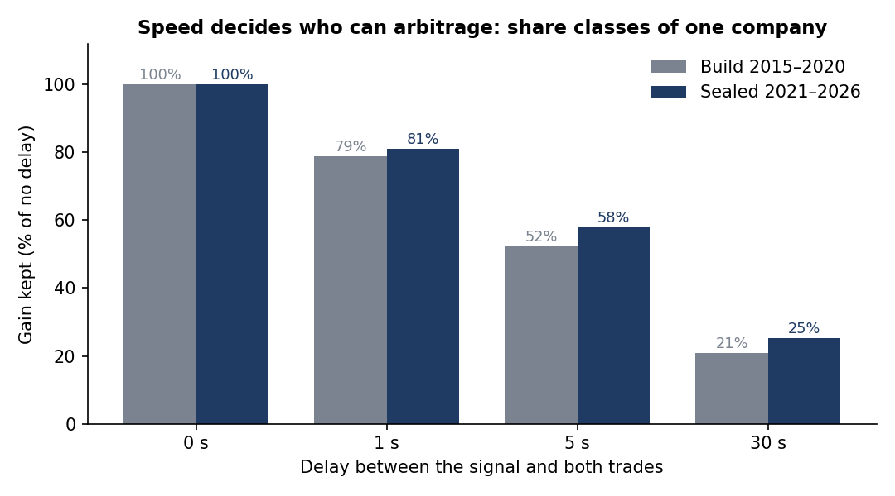
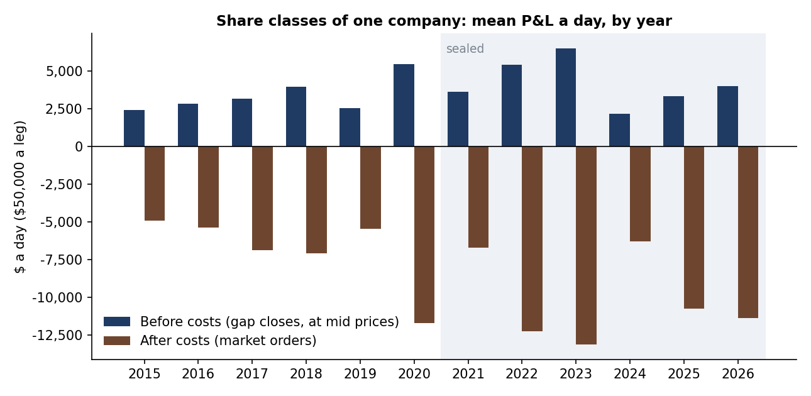

# Statistical arbitrage on near-identical prices

**Question.** When two prices that should move together drift apart for a few minutes, does the gap close? And is closing it worth more than the cost of trading it?

**Design (pre-registered).**
- **Signal:** the z-score of the log price gap against its mean over the last W minutes, measured every 5 seconds. Enter (09:35–15:30) when |z| ≥ z_in and the gap's distance from its mean is at least κ × the two legs' relative spreads; exit when |z| ≤ 0.5, 30 minutes after entry, or at 15:55. No position is held overnight.
- **Four kinds of pairs:**
  - **Share classes of one company** (7 pairs in the sealed years, e.g. GOOGL/GOOG, FOXA/FOX), $50,000 a leg.
  - **Same-industry stocks** (4 pairs a year, e.g. V/MA) and **ETF twins** (4 a year, e.g. SPY/IVV), $50,000 a leg; plus control pairs of unrelated companies traded with the same rule.
  - **Big gaps only, wide universe:** ETF twins (correlation ≥ 0.995) and share classes, the 20 pairs a year with the most dollar volume in their less-traded leg, $10,000 a leg, market orders sent 1 second after the signal, entry only at |z| ≥ 3.
- **Hypotheses:** H1, the gap closes (P&L at mid prices > 0). H2, a profit after costs, tested only if a variant made money on build data (2015–2020).
- **Data:** TAQ 1-second bars; build 2015–2020, sealed 2021 – Nov 2026, opened once.

**Results: the gap closed in every kind of pair, and costs were bigger than the gain.**

| Pair type | Gain before costs | After costs | Gain as a share of cost |
|---|---|---|---|
| Share classes of one company | **+$4,174 a day** [+3,611, +5,025] | −$10,036 a day | 29% |
| Same-industry stocks | +$1,421 a day | −$3,582 a day | 28% |
| ETF twins | +$345 a day | −$585 a day | 37% |
| Big gaps only, 1 second late | +$24.7 a trade | −$0.7 a trade (−$0.23 a day) | 97% |

- First three rows: sealed 2021 – Nov 2026, the pre-registered H1 signal (W = 30 min, z_in = 2), market orders at the signal with no depth penalty (L0D0). Cost = gain − after-cost P&L. H1 was confirmed for all three (p < 0.001).
- Last row: build data 2015–2020 only (no setting made money, so its sealed data were never opened); the best setting (W = 30, z_in = 3, κ = 3), orders 1 second late, strictest fill rules (L3D1). Per trade: +$24.7 at mid, −$21.9 spread and fill cost, −$3.5 fees.

**Speed decides who can arbitrage** (share classes, sealed; gain at mid kept when both legs trade d seconds after the signal):

| Delay | 0 s | 1 s | 5 s | 30 s |
|---|---|---|---|---|
| Gain kept | 100% | **81%** | **58%** | **25%** |

**Other findings.**
- **A patient version cost more.** The share-class variant picked on build data used patient limit orders. On sealed data it lost $777 a day [−927, −650], more than market orders with the same signal (−$679).
- **The best variant still lost money after costs:** −$777 a day for share classes; the best ETF-twin variant made +$3.5 a day, not distinguishable from zero (p = 0.37); big gaps only, −$0.23 a day.
- **Control pairs also "reverted":** unrelated-company pairs traded with the same rule gained +$8.20 a trade before costs [+5.3, +11.7], against +$19.6 (same industry) and +$10.6 (ETF twins). Part of the measured reversion is not about the pairs being related.

**What it means.** The prices really do snap back, and on stocks and years the rules had never seen. But the snap-back is smaller than the spread a trader pays to take it, unless the trader can act within a second at near-zero cost.

**Caveats.**
- The gain before costs assumes trading at the mid price at the signal; our own market impact is not modeled.
- From 3 Nov 2025 the displayed sizes in the share-class bars are 100× too big, which removes the depth penalty under L3D1 ([details](data_unit_correction.md)); the L0D0 market-order results above do not use displayed sizes. The other pair types corrected the sizes when loading.

**Records.** Pre-registration files in [docs/preregistration](preregistration/) (study20 share classes, study21 same industry and ETF twins, study24 big gaps; tags `spec…`, `code-freeze…`, `test-run…`, `dev-run-24`).
