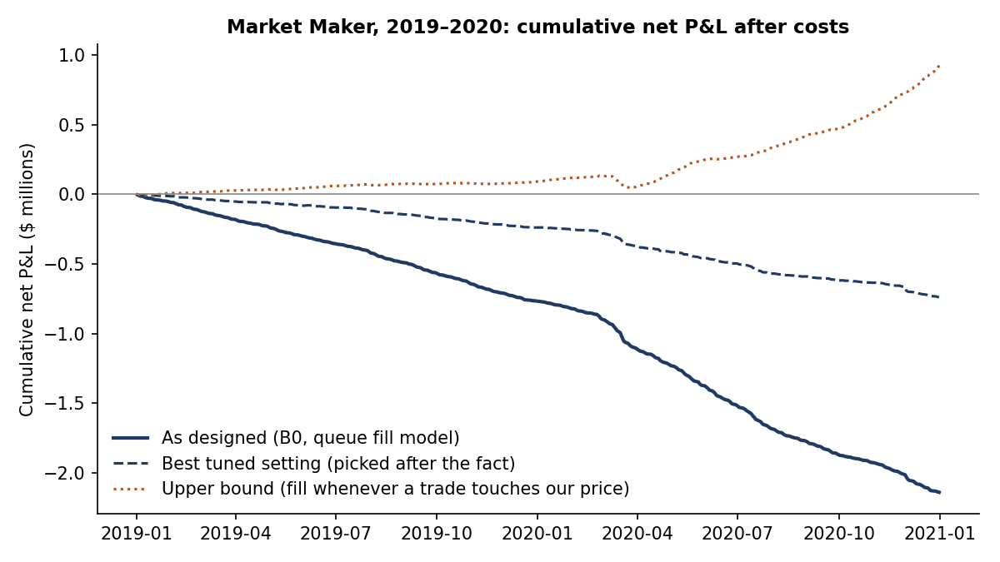

# Study 12 · Market Maker

**Question.** Can a passive market maker earn money after realistic costs? It quotes at the best bid and offer of wide-spread US stocks and decides once per second, without co-location.

**Data and period.** WRDS TAQ, reduced to 1-second NBBO and trade bars.
- **Stocks:** each year, 10 common stocks are drawn at random from those passing prior-year screens: price $10–150, median daily dollar volume $5M–100M, at least 3,000 trades a day, and a median spread of 3–12 ticks. That gives 20 names over the build period.
- **Build period:** 2019–2020 (505 days).
- **Sealed period:** 2021–2026 was never opened (see the test below).

**Algorithm rules (setting B0).**
- **Quoting:** from 09:45 to 15:55, whenever the spread is 2–12 ticks, join the best bid and the best ask with 100 shares each, re-posting every 5 s.
- **Inventory:** capped at ±300 shares. After 60 s at the cap, one 100-share lot is traded at market.
- **Close:** flat at 15:55.

**The grid.** 18 alternatives each changed one rule at a time. Every change that raised the Sharpe ratio by at least 0.5 was combined into **C_all**, the "best tuned" setting: keep queue place, a 500-share cap, a 120 s timer, long-only, spread ≥ 4 ticks, and an active-trading gate. The grid had 26 settings in total.

**Fill model and costs.**
- **Q (the verdict model):** our order waits behind the displayed queue and fills only after enough volume trades at our price.
- **T (optimistic upper bound):** fills in full whenever any trade touches our price.
- **Cost R:** market orders pay $0.003 a share plus the spread. Limit orders are free, with no rebate.

**Pre-registered pass/fail test.** Under Q and R, a setting qualifies only if all of these hold:
- Sharpe > 0 in both 2019 and 2020;
- Sharpe > 0 with half the queue;
- at least 1 fill per stock-day while staying under 1% of market volume;
- neighbouring settings have Sharpe ≥ 0.

If no setting qualifies, the study stops. A qualifier would also need a build Sharpe ≥ 1.0 before a single sealed run, judged by its 95% bootstrap CI (lower bound > 0 and Sharpe ≥ 0.5).

## Results

2019–2020, cost R, annualized Sharpe.

| Setting | Net | ¢/share | Sharpe | Losing days |
|---|---|---|---|---|
| B0, Q (as designed) | −$2.14M | −1.79 | −25.7 | 505 of 505 |
| C_all, Q (best tuned) | −$0.74M | −1.57 | −11.1 | 424 of 505 |
| B0, T (upper bound) | +$0.93M | +0.24 | +8.9 | 112 of 505 |

- **Volume:** B0 filled 107.8M shares with limit orders and 11.4M at market.
- **Where the loss comes from:** adverse selection. Five seconds after a fill, the mid-price had moved about 1.5 ticks against us.
- **Placebo:** the order-book imbalance filters did no better than shuffled signals.
- **Verdict:** 0 of 26 settings qualified.
- **Caveat on "best tuned":** C_all was tuned in-sample on the same build data. It is the best of the 26 grid settings, not of everything tried.

**Conclusion.** With a realistic queue, quoting at the best price lost money on every single day, because the fills we got were the ones that moved against us. Only the queue-free model made money, and it needed 13% of market volume to do so. Any edge depends on a queue position that a 1-second trader cannot secure. Study 16-B measures how much the queue position is worth (`study16_followups.md`). As pre-registered, the study stopped and the 2021–2026 data stayed unused.

*Sources:* `results/study12/` (`s12_summary.json`, `s12_daily_pnl.csv`, `dev_summary.json`, `dev_grid.csv`). Rules: `docs/preregistration/study12/`.
