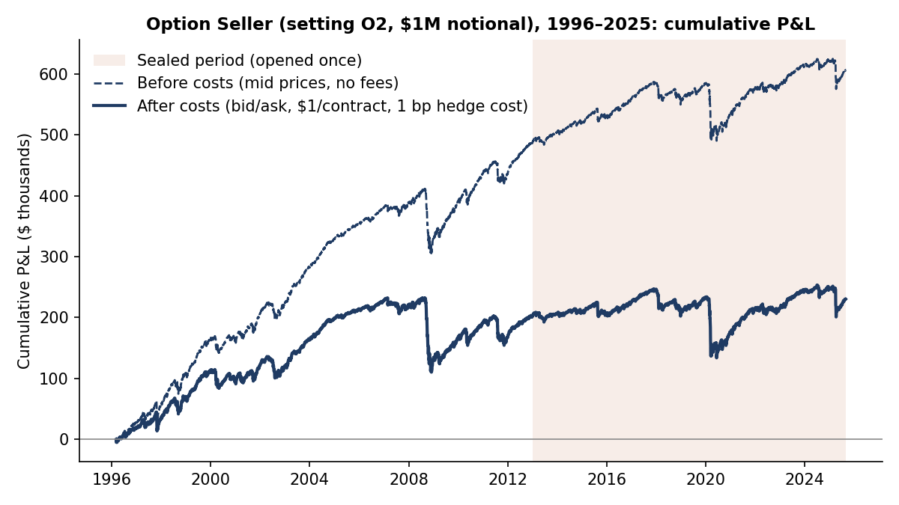

# Study 13–14 · Option Seller

**Question.** Does selling S&P 500 (SPX) index options to collect the volatility risk premium earn a Sharpe ratio of at least 0.5 after paying quoted bid/ask spreads, commissions and daily delta-hedging costs?

**Data and period.** OptionMetrics (WRDS) end-of-day SPX option quotes, implied-volatility surface and index closes.
- **Build period:** 1996-01-04 to 2012-12-31. Statistics start 1996-03-06, after the first positions are built up (4,235 trading days).
- **Sealed period:** 2013-01-02 to 2025-08-29 (3,185 days), opened once.

**Algorithm rules.** Every trading day the strategy opens a new tranche.
- It sells options on the standard monthly expiry nearest 45 days out, holds them 21 trading days and buys them back at the ask.
- About 21 overlapping tranches (1/21 of $1M notional each) are live at any time.
- Net option delta is hedged with the index at every close.

Eleven pre-registered variants (O0–O10) differ in structure, holding period, entry rule and sizing. Three were judged:
- **O2:** 16-delta strangle, constant size, no entry rule.
- **O8:** O2 sized by volatility (size × 0.16 / 30-day implied vol, clipped to 0.25–1.5).
- **O9:** O8, but it opens a tranche only when implied vol is above trailing 21-day realized vol.

**Costs (judged scenario).** Sell at the bid and buy at the ask, $1 per contract per side, and 1 bp per side on hedge trades. Two other scenarios are reported alongside it:
- **Mid-price / no-fee:** trades at mid, no fees, 0.25 bp hedge cost.
- **Stress:** heavier costs.

**How Study 13 and Study 14 relate.**
- Study 13 required four build-period filters, including Calmar ≥ 0.33. No variant passed (best Calmar 0.20), so under its own rules Study 13 ended as a negative result and its sealed-period script was never run.
- Study 14 was written **after** those build results were known, and says so. It dropped the Calmar filter and tested the three variants that passed the other filters (O2, O8, O9) on the sealed period. Those three tests are the only sealed run.

**Pre-registered test (each variant).**
- **Pass:** after-cost Sharpe ≥ 0.5 and the 98.33% block-bootstrap CI (Bonferroni for three tests) above 0.
- **Fail:** the CI's upper end below 0.5.
- **Inconclusive:** anything else.

## Results

Figures are on $1M notional and after costs unless noted.

| Variant | Build Sharpe | Sealed Sharpe [98.33% CI] | Max drawdown, build → sealed | Mid-price/no-fee Sharpe, build → sealed | Verdict |
|---|---|---|---|---|---|
| O2 | 0.55 | 0.10 [−0.68, 1.01] | 12.2% → 11.3% | 1.33 → 0.42 | inconclusive |
| O8 | 0.63 | 0.06 [−0.71, 0.97] | 7.8% → 11.9% | 1.45 → 0.44 | inconclusive |
| O9 | 0.61 | 0.08 [−0.55, 0.90] | 4.4% → 8.2% | 1.34 → 0.42 | inconclusive |

- **Benchmark:** SPX buy-and-hold (price index) had a Sharpe of 0.77 over the sealed period.
- **Return:** O2 earned 0.22% a year on notional in the sealed period.
- **Cost share:** costs took 76% of O2's mid-price P&L in the sealed period (58% in the build period).
- **Worst month:** March 2020 (−5.5% of notional).

**Conclusion.** No variant passed. The sealed Sharpe fell from about 0.6 to 0.1, far below simply holding the index. The CI is wide, so the formal verdict is "inconclusive" rather than "refuted". A premium is still there before costs, but spreads and fees consume most of it.

*Sources:* `results/study13_14/dev_summary.json`, `holdout_summary14.json`, `holdout_verdict14.json`, `option_seller_O2_daily.csv`. Rules: `docs/preregistration/study13_14/`.
