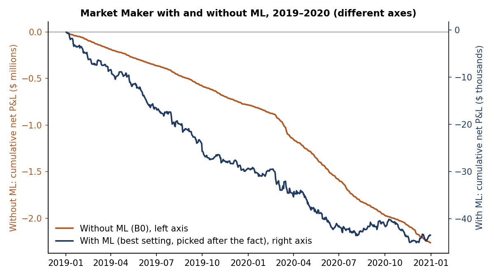
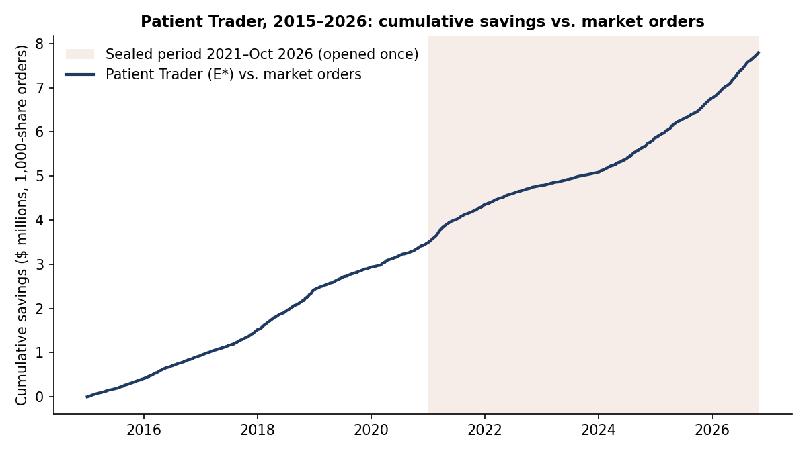

# Study 15 · Machine learning for the market maker, and the Patient Trader

**Question.**
1. Can machine learning that decides *when* to quote rescue the losing Study 12 market maker (setting B0)?
2. If not, can simple rules cut the cost of orders that must be filled anyway?

**Data and period.** WRDS TAQ, rebuilt as 1-second NBBO bars, 9:30–16:00.
- **Stocks:** each year, 10 randomly drawn US common stocks that pass a liquidity screen (median price $10–150, $5–100M daily dollar volume, ≥ 3,000 trades a day, 3–12¢ spread).
- **Periods:** development 2015–2020; sealed test 2021-01-04 to 2026-10-23.
- **Costs (scenario R):** 0.3¢ a share on market orders, 0 on limit orders. Limit orders fill only after the displayed queue ahead of them trades.

## Part 1 · ML market maker

**Model.**
- **Inputs:** 31 inputs built only from past data: spread, displayed sizes and imbalance, recent price moves (1 s to 5 min), buy-versus-sell volume imbalance, volume, trade and quote counts, volatility and time of day.
- **Target:** the value of a 100-share quote, meaning fill times the price move 5, 30 or 60 s later.
- **Models:** ridge regression and LightGBM, with 252 settings. The strategy quotes only when the prediction clears a threshold.

**Validation.** Expanding folds. Fold A trains on 2015–2018 and validates on 2019; fold B trains on 2015–2019 and validates on 2020.

**Pre-registered selection.** The rule was "best mean daily Sharpe". It picked a setting that traded 96 times in 2019 and once in 2020. Its Sharpe values mean nothing, and it was never taken to a test.

**Best setting, picked after the fact.** LightGBM, with the most P&L per share among the 40 settings that had at least 1,000 fills in each fold.

| | B0 (no ML) | ML, best setting |
|---|---|---|
| 2019 (fold A) | −1.74¢/share, Sharpe −47.6 | −1.32¢/share, Sharpe −5.2 |
| 2020 (fold B) | −1.84¢/share, Sharpe −27.8 | −0.74¢/share, Sharpe −2.3 |
| Pooled, 505 days | −1.80¢/share, Sharpe −25.1 | **−1.05¢/share, Sharpe −3.7** |

The ML fills were better than randomly chosen B0 fills on the 5-second price move after the fill, but all 40 settings still lost money.

## Part 2 · Patient Trader (execution)

**Task.** 20 parent orders per stock-day, each 1,000 shares with a 300-second deadline and a random side and start time. Cost is the implementation shortfall against the arrival mid-price, plus fees.

**Methods.** Every method sends whatever is left at market when the deadline arrives.
- **S0:** market order at arrival.
- **S1:** TWAP.
- **S2:** rest at the best quote.
- **S2i:** rest 1 tick inside the spread when the spread is at least 3 ticks.

**Selection on 2015–2020.**
- **ML timing:** adding ML timing on top of S2i changed nothing. The orders were identical on 97.8–99.9% of 2019–2020 orders.
- **E\*:** a pre-written rule chose among 36 rule combinations: lowest mean yearly cost, with the fewest extra rules within 0.05¢ of the best.
- **Winner:** E\* = S2i plus "take at market when the spread is ≤ 2 ticks". Development cost was 2.61¢ for E\* against 3.80¢ for S0.

**Pre-registered test.** The test rule was written after development and before the sealed data were opened.
- **Statistic:** E\* − S0, with a 21-day block-bootstrap 95% CI.
- **"Saves"** if the upper bound is below 0.
- **Runs:** exactly once.

**Sealed result** (286,700 orders, 1,458 days)

| | Mean cost (¢/share) | E\* minus it [95% CI] |
|---|---|---|
| S0, market order | 4.79 | **−1.50 [−1.67, −1.33]** |
| S1, TWAP | 4.69 | −1.40 [−1.55, −1.25] |
| S2i, passive only | 3.32 | −0.03 [−0.04, −0.02] |
| **E\*** | **3.29** | — |

- **Savings:** $4.30M, or 2.75 bp of $15.6B traded value. The Sharpe ratio of daily savings is 17.9.
- **E\* − S0 by year (¢):** 2021 −1.70, 2022 −0.88, 2023 −0.64, 2024 −1.57, 2025 −1.79, 2026 −2.52.
- **Tail cost:** E\*'s 95th-percentile cost is 20.3¢, against 13.8¢ for S0. Patience sometimes ends in a worse forced fill.
- **Predictions:** 4 of 6 predictions written before the test were right (mean Brier score 0.24).

**Conclusion.** ML cut the market maker's loss per share, but it still loses. Resting inside the spread beat immediate market orders in six unseen years. Nearly all of the gain comes from S2i, not from ML or the extra rule.

**Caveats:** fills are simulated, there is no market impact, and the engine fills market orders at the best quote at any size. Study 16 stress-tests these assumptions (`study16_followups.md`).

*Sources:* `results/study15/` (`s15_ml_summary.json`, `s15_ml_daily_pnl.csv`, `selection15.json`, `val15_fold_*.csv`, `r2_15_selection.json`, `test15_summary.json`, `s15_exec_daily.csv`). Rules: `docs/preregistration/study15/`.
