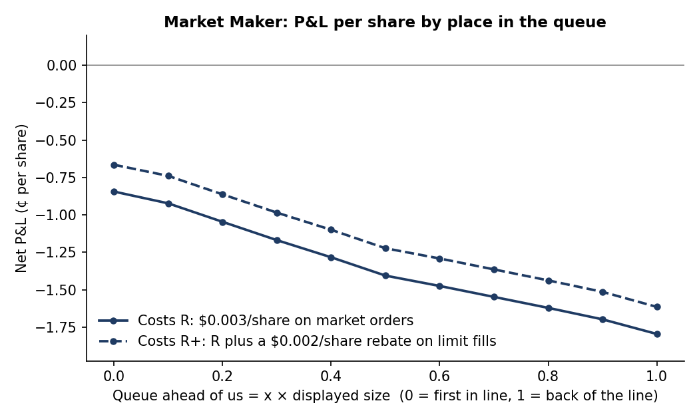
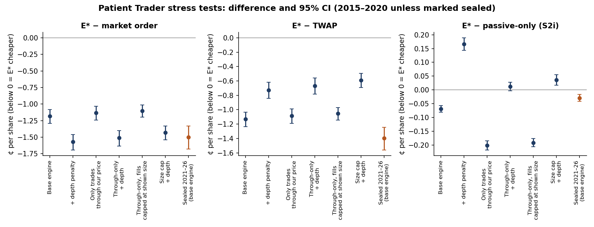

# Study 16 · Follow-ups: a signal gate, the queue-position diagnostic, and stress tests of the Patient Trader

Study 16 has four parts, each with its own rule file written before any number was computed (`docs/preregistration/study16/`). All new simulations use only the 2015–2020 build data. The sealed 2021–2026 period was not re-run; its stored test results were only summarised.

## 16-A · Gate: can a cheap execution rescue a daily reversal signal?

**Question.** Study 15's Patient Trader cut round-trip trading cost to about 5.2¢ a share, against 7.6¢ for market orders. Does a simple daily reversal signal earn more than that?

**Data and rule.** CRSP daily data, signals 2015-01-02 to 2020-12-30.
- **Universe:** US common stocks with mid-price $10–150, spread 3–12¢ and at least $5M average daily dollar volume. That averaged 366 stocks a day.
- **Positions:** each day, buy the 20% that fell most relative to the day's average and sell the 20% that rose most, equal dollars each, held one day.
- **Prices:** quote midpoints throughout, so bid–ask bounce cannot fake a reversal.

**Pre-registered gate.** G = gross profit per share per round trip.
- **Stop** if G < 5.2¢.
- **Continue** if 5.2¢ ≤ G < 7.6¢.
- **Continue as an add-on** if G ≥ 7.6¢.

**Result.** G = **−0.05¢** per share, 95% CI [−1.14, +0.93], over 219,976 positions on 1,510 days. **Stop:** there is no gross edge for cheap execution to save.

## 16-B · Diagnostic: how fast would the market maker need to be?

**Question.** Study 12's market maker lost money with orders that wait behind the displayed queue. Would standing at the front of the line fix it?

**Method.** We re-ran the Study 12 design (2019–2020, 20 stocks, 505 days) with the queue ahead of our order set to x × the displayed size, for x = 0, 0.1, …, 1.0. x = 1 reproduces Study 12 exactly; the check matched to $0.00 on every day. This is a diagnostic, so there is no pass/fail verdict.

| Place in line | Net ¢/share, costs R | Net ¢/share, R + 0.2¢ rebate | Sharpe (R) | Losing days (R) |
|---|---|---|---|---|
| Back of the line (x = 1) | −1.79 | −1.61 | −25.7 | 100% |
| **First in line (x = 0)** | **−0.84** | **−0.66** | −19.5 | 99.6% |
| Optimistic "touch" fill model | +0.24 | +0.43 | 8.9 | 22% |

**Reading.**
- Moving from the back of the line to the front is worth about 0.95¢ a share, but the strategy still loses at every x. Break-even and Sharpe-0.5 positions do not exist on this grid, even with the exchange rebate.
- The optimistic model fills us whenever a trade touches our price, and it is profitable. The 1.08¢ gap between it and "first in line" is the price of being filled by traders who know the price is about to move.

## 16-C and 16-D · Stress tests of the Patient Trader (E*)

**Question.** Is E*'s saving an artefact of optimistic simulator assumptions?

**Method.** The Study 15 execution engine was re-run on the 2015–2020 orders (295,960 parent orders, 1,511 days) with stricter assumptions. E*'s rule, the order design (1,000 shares, 300 s) and the cost scenario were fixed.

**Limit-order fills**
- **L0:** the engine as built.
- **L2:** only trades *through* our price fill us, never trades at it.
- **L3:** L2, plus a fill caused by the opposite quote reaching our price is capped at the displayed size.
- **L1:** off-exchange (TRF) trades cannot fill us. It was pre-registered but skipped, because the 1-second bars carry no exchange code.

**Market orders**
- **D0:** the engine as built.
- **D1:** every share beyond the displayed best size costs 1¢ more.

**Pre-registered verdict.** The result is "robust" if the most conservative variant still has the upper end of the 95% CI for E* − S0 below 0. The CI is a daily circular block bootstrap with 21-day blocks, 10,000 draws and seed 16.

| Variant | E* − market order | E* − TWAP | E* − passive-only (S2i) |
|---|---|---|---|
| L0D0 (as built) | −1.18 [−1.29, −1.08] | −1.13 [−1.24, −1.04] | −0.07 [−0.08, −0.06] |
| L2D1 | −1.51 [−1.63, −1.40] | −0.67 [−0.78, −0.56] | +0.01 [−0.00, +0.03] |
| L3D0 | −1.10 [−1.20, −1.01] | −1.05 [−1.14, −0.97] | −0.19 [−0.21, −0.18] |
| **L3D1 (strictest)** | **−1.43 [−1.54, −1.33]** | −0.59 [−0.69, −0.49] | +0.04 [+0.02, +0.06] |
| Sealed 2021–26, stored test results (L0D0) | −1.50 [−1.68, −1.33] | −1.40 [−1.56, −1.25] | −0.03 [−0.04, −0.02] |

Values are ¢ per share with 95% CIs; below 0 means E* is cheaper. The sealed row re-computes the CI with seed 16. The pre-registered Study 15 test (seed 15) gave −1.50 [−1.67, −1.33].

**Verdict: robust** in both 16-C (L2D1) and 16-D (L3D1).
- **Size cap alone:** comparing D0 variants, capping fills at the displayed size keeps 93% of the saving against market orders.
- **Where the saving comes from:** almost all of it comes from shares bought with limit orders (+1.90¢ of the 1.18¢ total in L0D0).
  - Market orders sent when the spread narrows contribute about 0.
  - Shares forced out at the deadline give back about 0.67¢.
- **What does not survive:** E*'s small edge over a purely passive order (S2i) depends on the market-depth assumption. Under D1 it disappears or reverses. The claim that holds is "E* beats market orders and TWAP", not "E* beats waiting".

**Checks.** Every variant first reproduced the stored Study 15 results to three decimals. Hand-traced example orders matched the engine, and no date after 2020 was used.

**Trials.** All configurations are counted across studies 1–16. The count reached 692 after 16-A, 714 after 16-B, 720 after 16-C and 722 after 16-D.

*Sources:* `results/study16/` (`gate16_result.json`, `queue16_sweep.csv`, `robust16_summary.csv`, `qty16_summary.csv` and the result JSONs). Rules and the deviations log: `docs/preregistration/study16/`.
