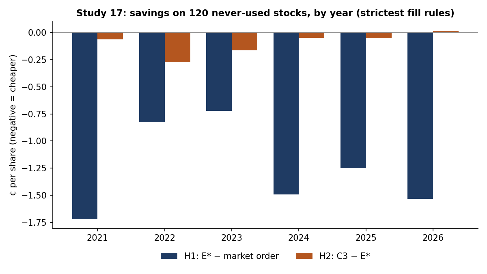

# Study 17: Replication on 120 never-used stocks

**Question.** Was the Patient Trader's saving specific to the stocks we happened to study? And does adjusting patience to market conditions help?

**Design (pre-registered, tag `spec17`).**
- **New universe:** 20 stocks a year for 2021–2026, drawn at random (seed 17) from stocks that pass the Study 12/15 selection filters, excluding every stock used in any earlier study.
- **Same order setup as Study 15:** 1,000-share parent orders. Anything left at the deadline is bought or sold at market, so every method fills the same quantity.
- **Candidates:** six candidates (C0–C5) were compared on development data only (old universe, 2015–2020). The rule was set in advance: pick the lowest mean cost under the strictest fill rules. The pick was **C3, a spread switch:** when the spread is 4¢ or less, just wait 1¢ inside the spread; otherwise use E*. Development result: C3 − E* = −0.076 ¢/share.
- **Freeze and sealed run:** code and predictions were frozen (tag `code-freeze-17`), and the sealed data were opened once with a typed unlock phrase (tag `test-run-17`).
- **Tests:** H1 (E* − market order) and H2 (C3 − E*).
  - Primary fill model: L3D1, the strictest (only trades through our price, at most the displayed size, depth penalty). Secondary: L0D0, the original.
  - Statistics: day-level circular block bootstrap (21-day blocks, 10,000 draws), one-sided, Holm-corrected (0.025, 0.05).

**Results (sealed; 556,900 orders over 1,465 trading days).**

| Test | Mean (¢/share) | One-sided 97.5% bound | Verdict | Original fill rules (L0D0) |
|---|---|---|---|---|
| H1: E* − market order | **−1.252** | −1.140 | Confirmed | −1.158 |
| H2: C3 − E* | **−0.098** | −0.075 | Confirmed | −0.026 |

- **H1 by year:** −1.72, −0.83, −0.72, −1.49, −1.25, −1.53 (2021–2026). Negative in every year and in all nine volatility × volume cells.
- **H2 by year:** −0.06, −0.27, −0.16, −0.05, −0.05, +0.02.
- **Other comparisons:**
  - E* − TWAP: −0.59¢ (strictest rules).
  - Common stocks only: H1 −1.30¢.
  - C3 − simple waiting (S2i): only −0.023¢. Nearly all the saving comes from waiting 1¢ inside the spread, not from the switch.

**Caveats.**
- Waiting makes the bad cases worse: the worst 5% of orders cost more with E* than with market orders (95th percentile 19.4¢ vs 12.6¢ a share).
- Fills are simulated, and our orders' own market impact is not modeled.
- H2 is statistically clear but economically small.

**Predictions.** Written before the run: 4 of 4 came true (Brier score 0.164). Cumulative trials across all studies: 730.

